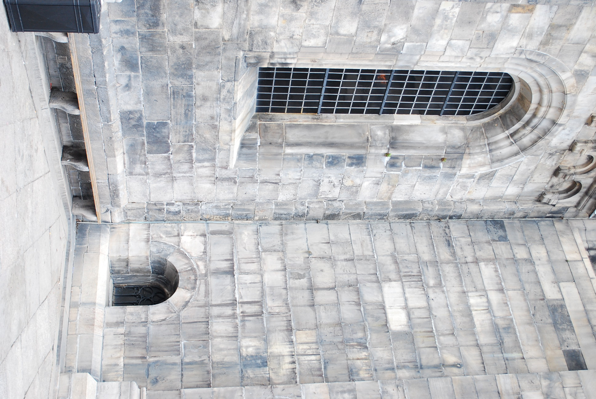
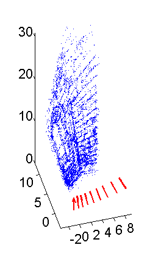
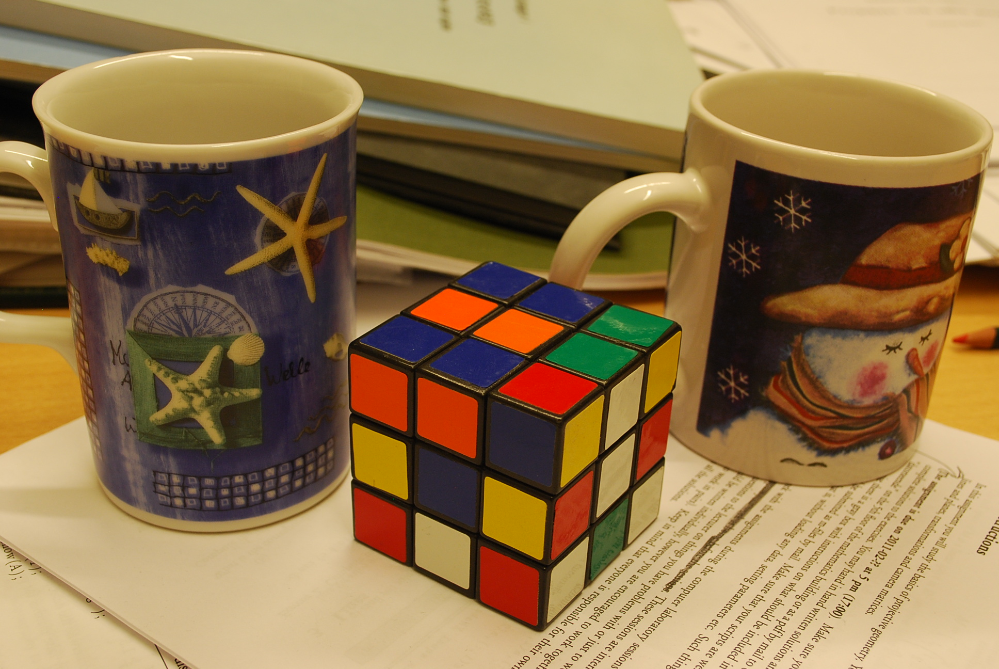
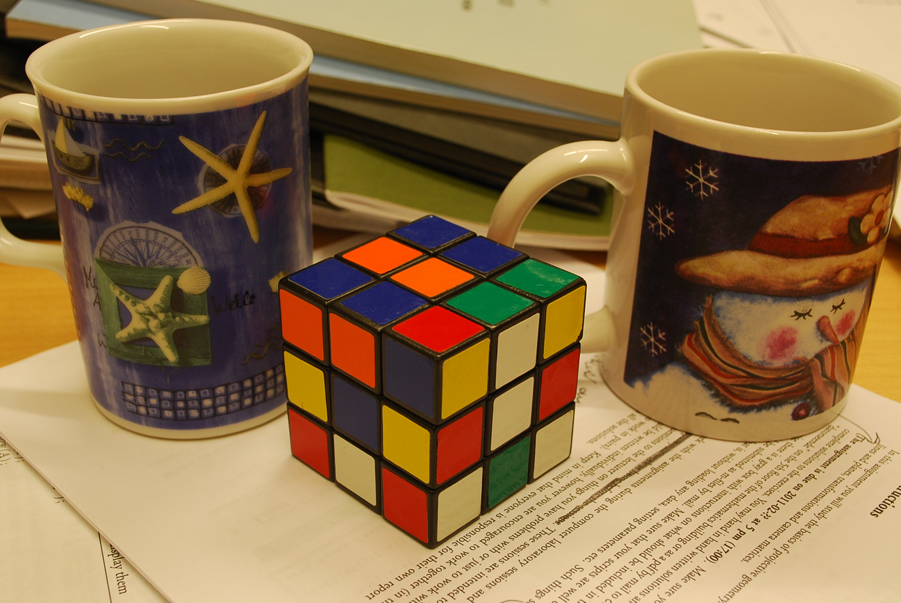

In this assignment you will study camera calibration, the projective ambiguity, and the DLT method. 

You will solve the resection and triangulation problems using DLT and compute inner parameters using RQ factorization.
In addition you will try out SIFT for feature detection/matching.

Please see Canvas for detailed instructions on what is expected for a passing/higher grade. All computer exercises not marked **OPTIONAL** are "mandatory" in the sense described on Canvas.

### Submission Requirements:
Your final lab submission should include:
1. Your edited **notebook file** (`.ipynb`).
2. An **HTML printout** of the executed notebook with all outputs visible: File → Save and export Notebook As → HTML
3. A **pdf report** containing answers to the theoretical exercises (see separate document).


```{python}
# for creating responsive plots

#for vscode
#%matplotlib widget  

#for running notebook in terminal
%matplotlib tk 

import cv2
import matplotlib.image as mpimg
from mpl_toolkits.mplot3d import Axes3D
import matplotlib.pyplot as plt
import numpy as np
import scipy
import scipy.io

from supplied import pflat, plot_camera
```

# Calibrated vs. Uncalibrated Reconstruction

#### *Theoretical exercise 1* (see pdf)

## Computer Exercise 1
Figure 1 shows an image of a scene and a reconstruction using uncalibrated cameras. The file `compEx1data.mat` contains 
the 3D points of the reconstruction `X`, the camera matrices `P`, the image points `x` and the filenames `imfiles` of the images.
Here `X` is a $4 \times 9471$ matrix containing the homogeneous coordinates for all 3D points, `x{i}` is a $3 \times 9471$ matrix containing the homogeneous coordinates of the image points seen in image $i$ (`NaN` means that the point has not been detected in this image). `P{i}` contains the camera matrix of image $i$ and `imfiles{i}` contains the name of that image.

<figure align="center">
    
&nbsp; &nbsp; &nbsp; &nbsp;
    
    <figcaption>Figure 1: Left: An image of the scene. Right: A projective (uncalibrated) reconstruction.</figcaption>
</figure>

### Task 1.1
Plot the 3D points of the reconstruction. Use the supplied function `plot_camera` to plot the cameras in the same figure.

**Do the physical properties (such as the relative heights of each of the two walls, the angle in the corner, and the relation between the width, height, and depth dimensions) look realistic in the reconstruction?**

Don't forget to use `ax.set_aspect('equal')` when plotting -- otherwise you may get additional distortion. The reconstruction should look like the one shown in Figure 1.

```{python}
im1 = plt.imread("./figs/DSC_0025.JPG")
im2 = plt.imread("./figs/projective_rec.png")
fig,ax = plt.subplots(1,2, figsize=(10,6))
ax[0].imshow(im1)
ax[1].imshow(im2)
plt.show()
# ------ Your code here ------ 
data = scipy.io.loadmat("data/compEx1data")
#print(data)
x = data["x"][0]
P = data["P"][0]
X = pflat(data["X"])
imfiles = data["imfiles"][0]


n_pics = imfiles.shape[0]
fig = plt.figure()
ax = fig.add_subplot(projection="3d")
ax.scatter(*X[:-1,:], s = 0.09,color="blue")
for i in range(n_pics):
    plot_camera(camera_matrix = P[i],scale=3,ax = ax)
ax.set_xlabel("X")
ax.set_ylabel("Y")
ax.set_zlabel("Z")
ax.set_aspect("equal")
plt.show()


```

#### Your answer here: 

(*Include answers to all questions marked in bold.*)
# 
The physical look skewed and draged out upwards to the right. It looks like the right wall is much larger than the left wall with the window on it. But all lines still look straight but the distance is because of the angles being wrong.


### Task 1.2
Project the 3D points into **a camera** of your choice (only points that have been detected in that camera).
Plot the image, the projected points, and the image points in the same figure.

**Do the projections appear to be close to the corresponding image points?** (If not: Did you forget to divide by the third coordinate?)

**Useful python commands:**

`~np.isnan(x_i)` # to check which of the points are visible in image i

```{python}
# ------ Your code here ------ 
camera_points = pflat(x[0])
mask = ~np.isnan(camera_points).any(axis=0)
camera0_3d = X[:,mask]
projected_points = pflat(P[0]@camera0_3d)
camera0_x = pflat(x[0])
print(camera0_x.shape)
camera0_image = plt.imread(f"./data/{imfiles[0][0]}")
fig,ax = plt.subplots(figsize=(8,8))

ax.imshow(camera0_image)
ax.scatter(*camera0_x[:-1], label = "actuall points", color ="blue", s=5, alpha=0.8)
ax.scatter(*projected_points[:-1] , label = "projected_points", color="red", s=5, alpha= 0.8)


ax.set_aspect("equal")
fig.legend()
plt.show()
```

#### Your answer here: 

(*Include answers to all questions marked in bold.*)
#
Yes, they correspond really good and it seems to line up with the picture

### Task 1.3
Using the two projective transformations 
\begin{equation}
T_1 = \left( \begin{array}{cccc}
1 & 0 & 0 & 0\\
0 & 3 & 0 & 0\\ 
0 & 0 & 1 & 0\\
1/8 & 1/8 & 0 & 1
\end{array} \right) \text{ and }
T_2 = \left( \begin{array}{cccc}
1 & 0 & 0 & 0\\
0 & 1 & 0 & 0\\ 
0 & 0 & 1 & 0\\
1/16 & 1/16 & 0 & 1
\end{array} \right),
\end{equation}

transform the 3D points ($\mathbf{X} \mapsto T_i\mathbf{X}$), and accordingly the cameras (as in *Theoretical Exercise 1*), so that two new projective solutions are obtained.

For each of the solutions, plot the 3D points and cameras in the same figure. (Don't forget to divide the points by the fourth coordinate before plotting, and again don't forget to use `ax.set_aspect('equal')`. Feel free to use the provided `pflat` function.)

**What has happened to the 3D points?**
**Does any of them appear reasonable?**

```{python}
# ------ Your code here ------ 
T_1 = [[1,0,0,0],[0,3,0,0,],[0,0,1,0],[1/8,1/8,0,1]]
T_2 = [[1,0,0,0],[0,1,0,0],[0,0,1,0],[1/16,1/16,0,1]]

X_1 = pflat(T_1@X)
X_2 = pflat(T_2@X)

# plot T_1
fig = plt.figure()
ax = fig.add_subplot(projection="3d")
ax.scatter(*X[:-1,:], s = 0.09,color="blue", label="original points")
ax.scatter(*X_1[:-1,:], s = 0.09,color="red", label=r"$T_1$")
for i in range(n_pics):
    plot_camera(camera_matrix = P[i]@np.linalg.inv(T_1),scale=3,ax = ax)
ax.set_xlabel("X")
ax.set_ylabel("Y")
ax.set_zlabel("Z")
ax.set_aspect("equal")
ax.set_title(r"$T_1$")
ax.legend()
plt.show()

# plot T_2

fig = plt.figure()
ax = fig.add_subplot(projection="3d")
ax.scatter(*X[:-1,:], s = 0.09,color="blue", label="original points")
ax.scatter(*X_2[:-1,:], s = 0.09,color="red", label=r"$T_2$")
for i in range(n_pics):
    plot_camera(camera_matrix = P[i]@np.linalg.inv(T_2),scale=3,ax = ax)
ax.set_xlabel("X")
ax.set_ylabel("Y")
ax.set_zlabel("Z")
ax.set_aspect("equal")
ax.set_title(r"$T_2$")
ax.legend()
plt.show()
```


### Your answer here: 

(*Include answers to all questions marked in bold.*)
#
the transformation for T1 seems to have scaled it pretty well and it now looks much less skeewed so it's therefore also a lot different from the first coordinates. T2 looks worse, but you can still see a window if you look at it from the right angle. Both transformations got rotated and skewed.

### Task 1.4
For one of the 9 views, and for each of the new reconstructions (resulting from $T_1$ and $T_2$), project the new 3D points into its corresponding transformed camera.
Plot the pair of images along with the corresponding projected points, and the image points in the same figure. 
(Write a function `project_and_plot(P, Xs, xs, image)` that does this for you, it will be useful in the future.)

**How well do the projections and the image points align for the new reconstructions?**

```{python}
def project_and_plot(P, Xs, xs, image):
    """
    Project 3D points into an image using a camera matrix and plot the
    projected points together with the observed image points.

    Parameters
    ----------
    P : (3, 4) ndarray
        Camera projection matrix for the selected view.

    Xs : (4, N) ndarray
        Homogeneous 3D points, one point per column.

    xs : (3, N) ndarray
        Homogeneous 2D image points observed in the image. Points
        containing NaN should be filtered out before calling this function.

    image : ndarray (H, W, 3)
        The image corresponding to the given camera matrix P, typically
        loaded with mpimg.imread or a similar function.
    """
    # Your code here
    
    
    projected_points = pflat(P@Xs)
    camera0_x = pflat(xs)

    fig,ax = plt.subplots(figsize=(8,8))

    ax.imshow(image)
    ax.scatter(*camera0_x[:-1], label = "actuall points", color ="blue", s=5, alpha=0.8)
    ax.scatter(*projected_points[:-1] , label = "projected_points", color="red", s=5, alpha= 0.8)

    ax.set_xlim(0,image.shape[1])
    ax.set_ylim(image.shape[0],0)
    ax.set_aspect("equal")
    fig.legend()
    plt.show()

camera0_image = plt.imread(f"./data/{imfiles[0][0]}")
camera_points = pflat(x[0])
mask = ~np.isnan(camera_points).any(axis=0)
# Project and plot the reconstruction resulting from T_1

t1_3d_camera0 = T_1@X[:,mask]
camera_t1 = P[0]@np.linalg.inv(T_1)

project_and_plot(camera_t1,t1_3d_camera0, camera_points, camera0_image)

# Project and plot the reconstruction resulting from T_2

t2_3d_camera0 = T_2@X[:,mask]
camera_t2 = P[0]@np.linalg.inv(T_2)
project_and_plot(camera_t2,t2_3d_camera0, camera_points, camera0_image)
```

#### Your answer here: 

(*Include answers to all questions marked in bold.*)
#
Both of these plosts looks identical to the previous plot with the untransformed coordinates and camera which is in line with the theory question.

#### *Theoretical exercises: 2* (see pdf)

# Camera Calibration

#### *Theoretical exercises: 3* (see pdf)

# RQ Factorization and Computation of $K$

#### *Theoretical exercises: 4* (see pdf)

# Direct Linear Transformation DLT

#### *Theoretical exercises: 5 and 6* (see pdf)

## Computer Exercise 2
Figure 2 shows two images `cube1.JPG` and `cube2.JPG` of a scene with a Rubik's cube. 
The file `compEx2data.mat` contains a point model `Xmodel` of the visible cube sides, the measured projections `x` of the model points
in the two images and two variables `startind`, `endind` that can be used for plotting lines on the model surface.

<figure align="center">
    
&nbsp; &nbsp; &nbsp; &nbsp;
    
    <figcaption>Figure 2: Two images of a scene containing a Rubik's cube.</figcaption>
</figure>

The goal for this exercise is to determine the camera for each of the two views, i.e. resectioning.
*You should consider one view at a time*, i.e. apply your code for each view separately.

### Task 2.1
Normalize the measured points by applying a transformation $N$ that subtracts the mean of the points and then re-scales the coordinates by the standard deviation.
Here, compute mean and standard deviation for $x$ and $y$ separately (separating the coordinates is not crucial, but it helps during grading if you do this in a coherent way).

Plot the normalized points in a new figure. Verify that the points are centered around $(0,0)$ with standard deviation 1 for each of the coordinates.

Remember to print out the mean and standard deviation you used for normalizing x and y, for each camera.

```{python}

im21 = plt.imread("./figs/cube1.JPG")
im22  = plt.imread("./figs/cube2.JPG")
fig,ax = plt.subplots(1,2, figsize=(10,6))
ax[0].imshow(im21)
ax[1].imshow(im22)
plt.show()

```


```{python}
# ------ Your code here ------ 
data = scipy.io.loadmat("./data/compEx2data.mat")
image_points = data["x"][0]
startind = data["startind"]
endind = data["endind"]
X_3d = data["Xmodel"]
N_matrices = []

image_points = [pflat(points) for points in image_points]

for idx, camera_points in enumerate(image_points):
    x_mean = np.mean(camera_points[0])
    x_std = np.std(camera_points[0])

    y_mean = np.mean(camera_points[1])
    y_std = np.std(camera_points[1])

    print(f"Camera {idx}: mean = ({x_mean:.3f}, {y_mean:.3f}), std = ({x_std:.3f},{y_std:.3f})")
    N = [[1/x_std,0, -x_mean/x_std], [0,1/y_std, -y_mean/y_std], [0,0,1]]
    N_matrices.append(N)


fig, axs = plt.subplots(1,2, figsize=(8,13))

for idx,ax in enumerate(axs):
    normalized_points= pflat(N_matrices[idx]@image_points[idx])
    ax.scatter(normalized_points[0],normalized_points[1],label ="Normalized_points")
    print(f"Camera {idx} verification: mean = ({np.mean(normalized_points[0]):.2f}, {np.mean(normalized_points[1]):.2f}), standard deviation = ({np.std(normalized_points[0]):.2f},{np.std(normalized_points[1]):.2f})")
    ax.set_xlabel("x")
    ax.set_ylabel("y")
    ax.set_title(f"Camera {idx}")
    ax.legend()

fig.show()


```


### Task 2.2
Implement a function `estimate_camera_DLT` that sets up the DLT equations for resectioning, and solves the resulting homogeneous least squares system using SVD.

$$\min_{||v||^2 = 1}||Mv||^2$$

**Is the smallest singular value close to zero? How about $||Mv||$?**

**Useful python commands:**

`U, S, Vt = np.linalg.svd(M)` # compute SVD of a matrix

```{python}
def estimate_camera_DLT(x, Xmodel):
    """
    Estimate the camera projection matrix using the Direct Linear Transform (DLT).

    Parameters
    ----------
    x : ndarray, (N, 2)
        2D image points (u, v)
        beforehand.

    Xmodel : ndarray, (N, 3)
        Corresponding 3D model points (X, Y, Z). 

    Returns
    -------
    P : ndarray, (3, 4)
        The estimated camera projection matrix that maps 3D points to 2D
        image coordinates, up to an unknown scale factor.
    """
    # Your code here
    numb_points = len(Xmodel)

    m_3d= np.zeros((3*numb_points,4*3))
    vector_3d =np.hstack((Xmodel, np.ones(numb_points).reshape(numb_points,1)))

    for i,points in enumerate(vector_3d):
        for j in range(3):
            start_index=4*j
            stop_index = 4*j +4
            m_3d[3*i+j,start_index:stop_index] = points


    m_2d = np.zeros((3*numb_points,numb_points))
    vector_2d = -1 * np.hstack((x,np.ones(numb_points).reshape(numb_points,1)))

    for i,points in enumerate(vector_2d):
        start_index = 3*i
        stop_index = 3*i +3
        m_2d[start_index:stop_index,i] = points

    M= np.hstack((m_3d,m_2d))

    U,Sigma, Vt = np.linalg.svd(M, full_matrices=False)
    
    V = Vt.T 
    P = V[:12,-1].reshape(3,4)

    v = V[:,-1]
    print(f"||Mv|| = {np.linalg.norm(M @ v):.5f}, ||v|| = {np.linalg.norm(v):.5f}")
    print(f"Smallest sigma: {Sigma[-1]:.5f}")
    if np.mean(v[12:])<0:
        P = -P
    return P


data = scipy.io.loadmat("./data/compEx2data.mat")
X_3d = data["Xmodel"]
image_points = data["x"][0]

P_matrices = []
for idx in range(2):
    normalized_points= pflat(N_matrices[idx]@image_points[idx])[:-1]
    P_matrices.append(estimate_camera_DLT(normalized_points.T,X_3d.T))

print(f"P for camera 0: \n {P_matrices[0]}")
print(f"P for camera 1: \n {P_matrices[1]}")
    

```

#### Your answer here: 

(*Include answers to all questions marked in bold.*)
#
In the theory chapter we established that the smallest value that the M can have is the smallest singular value and therefore if we print this value we get that for camera 0 we get 0.015 and for camera 1 we get 0.012 which are two small values, it's not zero but away from 1 at least.

### Task 2.3
Extract the entries of the camera from the solution and set up the camera matrix.
Make sure that you select the solution where the points are in front of the camera.
(If $X$ has 4th coordinate 1 then the 3rd coordinate of $PX$ should be positive for $X$ to be in front of the camera.)

Project the model points into the images. (Don't forget to transform the camera matrix to the original (un-normalized) coordinate system, as in *Theoretiacl Exercise 6*, before projecting.) Plot the measured image points in the same figure. **Are they close to each other?** Also make a 3D plot visualizing the camera centers, principal axes, as well as the 3D model points.
**Does the result look reasonable?**

```{python}
# ------ Your code here ------ 

# extract the camera matrices

# Project and plot the models points into the images

# Make a 3D plot with 3D model points, camera centers, and principal axes

data = scipy.io.loadmat("./data/compEx2data.mat")
X_3d = data["Xmodel"]
image_points = data["x"][0]

im21 = plt.imread("./figs/cube1.JPG")
im22  = plt.imread("./figs/cube2.JPG")

images= [im21,im22]
n_points = image_points[0].shape[1]
X_homo = np.vstack((X_3d,np.ones(n_points).reshape(1,n_points)))
for idx in range(2): 

    P = np.linalg.inv(N_matrices[idx])@P_matrices[idx]
    project_and_plot(P,X_homo,image_points[idx],images[idx])


fig = plt.figure()
ax = fig.add_subplot(projection="3d")
ax.scatter(*X_3d, s=5)
for idx in range(2):
    plot_camera(np.linalg.inv(N_matrices[idx]) @ P_matrices[idx], 3, ax=ax)
ax.set_aspect("equal")
plt.show()
```

### Your answer here: 

(*Include answers to all questions marked in bold.*)
#
Yeah we can see a bit difference on both the picture but this is expected since the minimum value was not zero and, the points differ on different sides so this seems more as a measurement error than a bug in the code.

### Task 2.4
Compute the inner parameters of the first camera using RQ decomposition. 

**How can we know that these are the "true" parameters? Why is there no ambiguity as in Theoretical Exercise 1?**

Please also print out the calibration matrix of the first camera, normalized s.t. $K_{33}=1$.

When you have achieved satisfactory results, save the camera matrices (for both views) to be used in further exercises.

**Useful python commands:**

`scipy.linalg.rq(P)` # compute the RQ decomposition of a matrix

```{python}
# ------ Your code here ------
def get_K_matrix(P):

    K,R=scipy.linalg.rq(P[:,:-1])
    sign =np.diag(np.sign(np.diag(K)))
    k_22 = K[2,2]
    return K@sign/np.abs(k_22)


Ps = np.array([np.linalg.inv(N_matrices[idx])@P_matrices[idx] for idx in range(2)])
print(get_K_matrix(Ps[0]))

K_matrices = [get_K_matrix(Ps[0]),get_K_matrix(Ps[1])]


```

### Your answer here: 

(*Include answers to all questions marked in bold.*)
#
We know this because in that problem both the 3D points and the camera points where unknown. Here we know the 3D points and therefore we can calculate a unique P matrix. In Excercise 1 we only had pictures with image points and no 3D points.


### Task 2.5 (OPTIONAL, 10 optional points)
You will now re-run your experiments in a few different settings to be compared, investigating the importance of normalization. You only need to do this part for **the first view** (corresponding to 2D points `x{1}`). For each experiment, measure the performance with the RMS error 

$$
\begin{equation}
e_{RMS} = \sqrt{ \frac{1}{n} ||x_{meas} - x_{proj}||_F^2 },
\end{equation}
$$

where $x_{meas}$, $x_{proj}$ are the Cartesian coordinates ($2\times n$-matrices) for the measured points and projected model points respectively, and $n$ is the number of points. Here $|| \cdot ||_F^2$ denotes the (squared) Frobenius norm.

**Useful python commands:**

`np.linalg.norm(dx, 'fro') ** 2` # compute the squared Frobenius norm

```{python}
def e_rms(x_measured, x_projected):
    """
    Compute the RMS reprojection error between measured and projected 2D points.

    Parameters
    ----------
    x_measured : array_like, shape (2, N)
        Measured 2D image points in Cartesian coordinates.

    x_projected : array_like, shape (2, N)
        Projected 2D points (from the camera model) in Cartesian coordinates.
        Must correspond point-wise to `x_measured`.

    Returns
    -------
    float
        The RMS error defined as:

            sqrt( (1/N) * ||x_measured - x_projected||_F^2 )

        where ||·||_F is the Frobenius norm.
    """
    N = x_measured.shape[1]
    rms_error = np.sqrt( (1/N) * np.linalg.norm(x_measured - x_projected, ord ="fro")**2)
    return rms_error


```

First compute RMS values when using normalization (as you have done so far).
Next, repeat the whole resectioning experiment one more time, but this time don't normalize the points. (The easiest way of doing this is probably to use $N=I$ as normalization matrix and run the same code again.)

**Is the difference large?** 

Report the RMS number and explain your findings.

```{python}
# ------ Your code here ------

compare_N = [N_matrices[0], np.identity(3)]
data = scipy.io.loadmat("./data/compEx2data.mat")
X_3d = data["Xmodel"]
image_points = data["x"][0]
n_points = image_points[0].shape[1]
X_homo = np.vstack((X_3d,np.ones(n_points).reshape(1,n_points)))

for idx in range(2):
    normalized_points= pflat(compare_N[idx]@image_points[0])[:-1]
    print()
    p = estimate_camera_DLT(normalized_points.T,X_3d.T)
    projected_2d = pflat(np.linalg.inv(compare_N[idx])@p@X_homo)
    print(f"RMSE: {e_rms(image_points[0],pflat(projected_2d)):.4f}")


```


### Your answer here: 

(*Include answers to all questions marked in bold.*)
#
The difference is around 1.3 which is better so normalization clearly helps a bit.

Now repeat the resectioning experiments (with and without normalization), but this time estimate the camera using only points number $1,4,13,16,25,28,31$. Still, measure the RMS error in a unified way, always using all points!.

**What can you conclude from the experiments that you have run?**

```{python}
# ------ Your code here ------

compare_N = [N_matrices[0], np.identity(3)]
data = scipy.io.loadmat("./data/compEx2data.mat")

index_points = np.array([0,3,12,15,24,27,30])

image_points = data["x"][0]

sampled_image_points = image_points[0][:,index_points]
X_3d_samples = data["Xmodel"][:,index_points]
n_samples = len(index_points)

for idx in range(2):
    normalized_points= pflat(compare_N[idx]@sampled_image_points)[:-1]
    print()
    p = estimate_camera_DLT(normalized_points.T,X_3d_samples.T)
    projected_2d = pflat(np.linalg.inv(compare_N[idx])@p@X_homo)
    print(f"RMSE: {e_rms(image_points[0],pflat(projected_2d)):.4f}")

```

### Your answer here: 

(*Include answers to all questions marked in bold.*)
#
Here the error is much larger and the error for the the first is just a litle bit worse so this makes normalization much better than the un-normalized.

# Feature Extraction and Matching using SIFT

## Computer Exercise 3
In this exercise you will get to try feature extraction using SIFT.

You will need `OpenCV` package for computing SIFT features so first make sure that you have the package installed and successfully imported. 

### Task 3.1
First load the images `cube1.jpg` and `cube2.jpg` from Computer Exercise 2. We will work with **grayscale** images for SIFT.

Compute SIFT features using OpenCV’s implementation of SIFT. 

**Useful python commands:**

`sift = cv2.SIFT_create(contrastThreshold=0.01)` # initialize a sift detector

`keypoints1, descriptors1 = sift.detectAndCompute(im1, None)` # compute keypoints and descriptors


The SIFT detector searches for peaks in scale space (similar to peaks in the autocorrelation function, see lecture notes). The `contrastThreshold` parameter filters out weak peaks.

The variable `keypoints1` contains a list of detected features `kp`. Each keypoint has: 
- `kp.pt` -- $(x, y)$ coordinates
- `kp.angle` -- an orientation
- `kp.size` -- a scale

and the descriptor in `descriptors1` encodes local image information around that point.

```{python}
# ------ Your code here ------

# load images in greyscale
cube1_grey =cv2.imread("./data/cube1.JPG", cv2.IMREAD_GRAYSCALE)
cube2_grey =cv2.imread("./data/cube2.JPG", cv2.IMREAD_GRAYSCALE)

# compute keypoints and descriptors for both images
sift = cv2.SIFT_create(contrastThreshold=0.01)
keypoints1,descriptors1 = sift.detectAndCompute(cube1_grey,None)
keypoints2,descriptors2 = sift.detectAndCompute(cube2_grey,None)

```

Visualize the detected keypoints with the images.
```
im1_kp = cv2.drawKeypoints(im1, keypoints1, None,
                           flags=cv2.DRAW_MATCHES_FLAGS_DRAW_RICH_KEYPOINTS)
```

```{python}
# ------ Your code here ------

im1_kp = cv2.drawKeypoints(cube1_grey, keypoints1, None,flags=cv2.DRAW_MATCHES_FLAGS_DRAW_RICH_KEYPOINTS)

im2_kp = cv2.drawKeypoints(cube2_grey ,keypoints2, None, flags=cv2.DRAW_MATCHES_FLAGS_DRAW_RICH_KEYPOINTS)

plt.imshow(im1_kp)
plt.show()
plt.figure()
plt.imshow(im2_kp)
plt.show()

```

### Task 3.2
We now want to find correspondences between the two sets of SIFT descriptors.

```
bf = cv2.BFMatcher(cv2.NORM_L2)
matches = bf.knnMatch(descriptors1, descriptors2, k=2)
```

For each descriptor in the first image, `bf.knnMatch.knnMatch()` returns `k` best matches in the second image, where `k=2` by default. 

However, sometimes a feature may have two or more similarly good matches, especially in textured or repetitive regions — these are ambiguous and should not be trusted.

We can apply **Lowe's ratio test** to filter out these ambiguous matches by comparing the distance of the best match (`m`) to the second-best match (`n`) and keep only the matches if the best match is much better than the second best (e.g. `m.distance < 0.75 * n.distance`).

Otherwise, both matches are almost equally good, the match is ambiguous, and we should reject it.

```{python}
# ------ Your code here ------

# Compute matches between descriptors1 and descriptors2
bf = cv2.BFMatcher(cv2.NORM_L2)
matches = bf.knnMatch(descriptors1,descriptors2, k=2)

# Apply Lowe's ratio test to filter out the ambiguous mathes

saved_points=[]
for point in matches:
    m,n=point 
    if m.distance < 0.75*n.distance:
        saved_points.append(m)

print(f"Saved points: {len(saved_points)}")
```

### Task 3.3
We can now extract matching points as follows. (Note that you will need the point sets $x1$ and $x2$ for the next exercise.)
```
x1 = np.array([keypoints1[m.queryIdx].pt for m in good_matches]).T
x2 = np.array([keypoints2[m.trainIdx].pt for m in good_matches]).T
```

Randomly select 10 matches, plot the two images next to each other and plots lines between the matching points.

**How many of the matches appear to be correct?**

**Useful python commands:**

```
im_matches = cv2.drawMatchesKnn(im1, keypoints1,
                                im2, keypoints2,
                                selected_matches, None,
                                flags=cv2.DrawMatchesFlags_NOT_DRAW_SINGLE_POINTS)
```

```{python}
# ------ Your code here ------
im_cube1 = cv2.imread("./data/cube1.JPG")
im_cube2 = cv2.imread("./data/cube2.JPG")
# Extract matching points


x1 = np.array([keypoints1[m.queryIdx].pt for m in saved_points]).T
x2 = np.array([keypoints2[m.trainIdx].pt for m in saved_points]).T

n_points=x1.shape[1]


gen = np.random.default_rng(seed=42)

sampled_points = gen.choice(saved_points,size=10, replace=False)


# Plot matching points on the two images

im_matches = cv2.drawMatches(im_cube1, keypoints1,
                                im_cube2, keypoints2,
                                sampled_points, None,
                                flags=cv2.DrawMatchesFlags_NOT_DRAW_SINGLE_POINTS)

plt.figure(figsize=(15, 8))
plt.imshow(im_matches)   # cv2 loads BGR, so convert for matplotlib
plt.show()
```


### Your answer here: 

(*Include answers to all questions marked in bold.*)
#
All 10 except the pink one (the point highest up in the picture)

# Triangulation using DLT

## Computer Exercise 4
Using the estimated cameras from Computer Exercise 2 you will now triangulate the points detected in Computer Exercise 3.

### Task 4.1
Implement a function `triangulate_3D_point_DLT` that set ups the DLT equations for triangulation, and solves the homogeneous least squares system.
(You will have to do this in a loop, once for each point.)

```{python}
def triangulate_3D_point_DLT(x1, x2, P1, P2):
    """
    Triangulate a single 3D point from two views using DLT.

    Parameters
    ----------
        x1, x2 : ndarray, (2, )
            2D points in the first/second image

        P1, P2 : ndarray, (3, 4) 
            Camera matrices of the first/second image
    
    Returns
    -------
        X : ndarray, (4, ) 
            Estimated 3D point in homogeneous coordinates.
    """

    # Your code here
    M_camera =np.vstack((P1,P2))
    x_1_homo = np.append(x1,1.0)
    x_2_homo = np.append(x2,1.0)
    M_image_coords = np.vstack(
        (np.hstack(
            (-x_1_homo,np.zeros(3))),
        np.hstack(
                (np.zeros(3),-x_2_homo)))).T
    
    
    M = np.hstack((M_camera,M_image_coords))

    _,_,Vt = np.linalg.svd(M)
    
    X= Vt.T[:4,-1]
    return X
    
```

Project the computed points into the two images and compare with the corresponding SIFT-points in a 2D plot.

```{python}
# ------ Your code here ------

# Compute the 3D points
images= [im21,im22]

image_coordinates = [np.vstack((x1,np.ones(n_points))),np.vstack((x2,np.ones(n_points)))]

Ps = np.array([np.linalg.inv(N_matrices[idx])@P_matrices[idx] for idx in range(2)])
Xs = pflat(np.array([triangulate_3D_point_DLT(point1,point2,Ps[0],Ps[1]) for point1, point2 in zip(x1.T,x2.T)]).T)


# Project the computed points into the two images

for i in range(2):
    project_and_plot(Ps[i],Xs,image_coordinates[i],images[i])
```

### Task 4.2
Now, re-run the triangulation, but first normalize 2D points and cameras using the inverse of $K$. Again, compare with the SIFT points in a plot.
Just as when normalizing with $N$ (based on mean/std) for the resection problem in Computer Exercise 2, how is your result for triangulation from normalization compared to the result without normalization? Note that using $K$ or $N$ for normalization doesn't matter much, but $K$ was not available for the previous problem (resection).

```{python}
# ------ Your code here ------
K_inv = [np.linalg.inv(K) for K in K_matrices]
Ps_norm = np.array([K_inv[idx]@np.linalg.inv(N_matrices[idx])@P_matrices[idx] for idx in range(2)])
x1_norm = K_inv[0]@image_coordinates[0]
x2_norm = K_inv[1]@image_coordinates[1]
x_norm = [x1_norm,x2_norm]
Xs_norm = pflat(np.array([triangulate_3D_point_DLT(point1[:-1],point2[:-1],Ps_norm[0],Ps_norm[1]) for point1, point2 in zip(x1_norm.T,x2_norm.T)]).T)

# Project the computed points into the two images

for i in range(2):
    project_and_plot(K_matrices[i]@Ps_norm[i],Xs_norm,K_matrices[i]@x_norm[i],images[i])
```

### Task 4.3
From now on, consider only the normalized case.

As we saw in Computer Exercise 3, a portion of the SIFT matches will be incorrect. Most of the time (but not always) this will result in triangulations with large error.
Compute the average pixel error (for each of the two images) between the projected 3D points and the corresponding SIFT points (remember to multiply with $K$ to retrieve pixel coordinates rather than normalized coordinates).

Remove those points for which the error in at least one of the images is larger than $3$ pixels.
Plot the remaining 3D points, the cameras and the cube model in one and the same 3D plot. 

**Can you distinguish the dominant objects (the cups and the paper)?**

```{python}
# ------ Your code here ------


X_3d = data["Xmodel"]
projected_x_camera0=pflat(K_matrices[0]@Ps_norm[0]@Xs_norm)
projected_x_camera1=pflat(K_matrices[1]@Ps_norm[1]@Xs_norm)
sift_x_camera0= pflat(K_matrices[0]@x_norm[0])
sift_x_camera1 = pflat(K_matrices[1]@x_norm[1])

#all_points_projected= np.hstack((projected_x_camera0,projected_x_camera1))
all_points_sift = np.hstack((sift_x_camera0,sift_x_camera1))

average_pixel_error_camera_0 = np.mean(np.linalg.norm(projected_x_camera0 - sift_x_camera0, axis=0))
average_pixel_error_camera_1 = np.mean(np.linalg.norm(projected_x_camera1 - sift_x_camera1, axis=0))

print(f"Average pixel error camera 0: {average_pixel_error_camera_0:.3f}")
print(f"Average pixel error camera 1: {average_pixel_error_camera_1:.3f}")

err0 =np.linalg.norm(projected_x_camera0 - sift_x_camera0, axis = 0)<=3
err1=np.linalg.norm(projected_x_camera1 - sift_x_camera1, axis = 0)<=3 
mask = err0 & err1
X_best = Xs_norm[:,mask]


fig = plt.figure()
ax = fig.add_subplot(projection="3d")
plot_camera(Ps[0],3, ax = ax)
plot_camera(Ps[1],3, ax = ax)
ax.scatter(*X_best[:-1], s= 0.1, label="SIFT")
ax.scatter(*X_3d,color="red" ,s= 5, label ="Cube corners")
ax.set_xlabel("X")
ax.set_ylabel("Y")
ax.set_zlabel("Z")
ax.set_aspect("equal")
ax.set_xlim(-20,20)
ax.set_ylim(-20,20)
ax.set_zlim(-20,20)
fig.legend()
plt.show()
```

### Your answer here: 

(*Include answers to all questions marked in bold.*)
#
Yes you can see that the text is there and also a surface that resembles the mug
